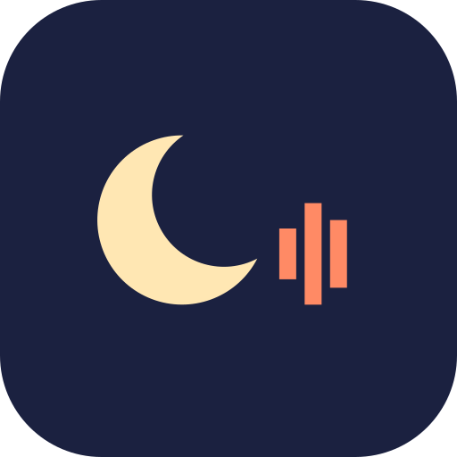
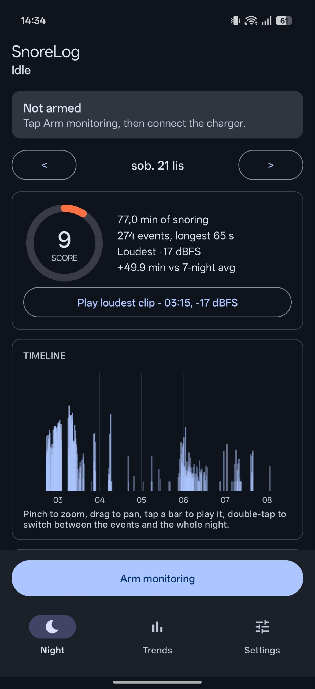

<p align="center">
  
</p>

<h1 align="center">SnoreLog</h1>

<p align="center">
  Measure your snoring overnight. Private, on-device, no internet.
</p>

An Android app that measures your snoring overnight, keeps short timestamped clips, and shows you charts, scores and trends. Everything is recorded and analysed **on your phone**. The app has no internet access.

<p align="center">
  
</p>

## How it was made

SnoreLog is about 95% vibe-coded: the code was written through AI-assisted prompting, while the author decided what the app should do and tested it on real phones (OnePlus, Samsung, Pixel, Oppo). It has not had a formal code review or security audit. It works for the author, so read the code before you trust it, and use it at your own risk. Pull requests and bug reports are welcome.

## Features

- **Arm once, sleep.** Records while the phone is charging (optional battery mode). Optional "record only while the screen is off".
- **Smart disarm.** Disarm after your Clock alarm, when you unplug, or when you start using the phone in the morning. All of it is configurable.
- **Only real events.** Adaptive noise floor plus an on-device AI classifier (YAMNet) that tells snoring from other noise. Adjustable threshold and a live test mode.
- **Timeline and score.** Per-night sleep score, minute-by-minute timeline, loudest clip of the night, 14-night chart, calendar and tag insights (alcohol, congestion, late meal, back sleeping, stress).
- **Small clips.** Mono AAC at 16 kbps (about 2 kB per second of audio), automatic clean-up after N days.
- **Backup and restore** to a single ZIP file. CSV export.
- **Extras.** Home-screen widget, experimental breathing-pause markers, overheating guard, watchdog alert, bedside mode, English and Polish UI, Material 3 with dynamic colours.

Full documentation: [`docs/SnoreLog_Manual.pdf`](docs/SnoreLog_Manual.pdf).

> **Not a medical device.** SnoreLog does not diagnose sleep apnea or any other condition. If you or a partner notice choking or gasping, or you are very sleepy by day, see a doctor.

## Install

Requires Android 10 (API 29) or newer.

1. Download the latest `SnoreLog.apk` from the [Releases](../../releases) page (or from the *Build APK* workflow artifacts).
2. Allow installs from your browser or file manager when Android asks.
3. Open the app, allow microphone and notification access, and follow the battery prompt.

Builds are currently debug-signed. Updates install over each other only if they come from the same signing key.

## Build from source

Requirements: JDK 17, Gradle 8.9, Android SDK 35.

```sh
# The YAMNet model and class map are included in app/src/main/assets
gradle assembleDebug
# APK: app/build/outputs/apk/debug/app-debug.apk
```

The YAMNet model (`yamnet.tflite`, Apache 2.0, from Google) is stored in the repository, so every build includes it. It is what separates snoring from other noise.

The GitHub Actions workflow (`.github/workflows/build.yml`) builds on every push and fails if the model is missing or altered. Pushing a tag such as `v0.47` also publishes a release with the APK attached.

## Project layout

| Path | Contents |
|---|---|
| `app/src/main/java/app/snorelog/` | Kotlin sources: recorder service, UI, charts, database, backup |
| `app/src/main/assets/pl.tsv` | Polish translation (exact strings and regex rules) |
| `docs/` | User manual (PDF) and screenshots |

The UI is built programmatically with Material 3 (no XML layouts for the main screens). Settings live in SharedPreferences, events in SQLite, clips as m4a files in the app's storage.

## Privacy

See [`PRIVACY.md`](PRIVACY.md). Audio and statistics never leave the phone unless you export or back them up yourself.

## Licence

SnoreLog is free software under the **GNU General Public License v3.0**, see [`LICENSE`](LICENSE). You may use, study, change and share it, but any version you distribute must also be released under GPL-3.0 with its source code. Closed-source copies are not allowed.

Version 0.47 was first published under the MIT licence and remains available under those terms. Everything after it is GPL-3.0.

Third-party components: [`THIRD_PARTY_NOTICES.md`](THIRD_PARTY_NOTICES.md).
